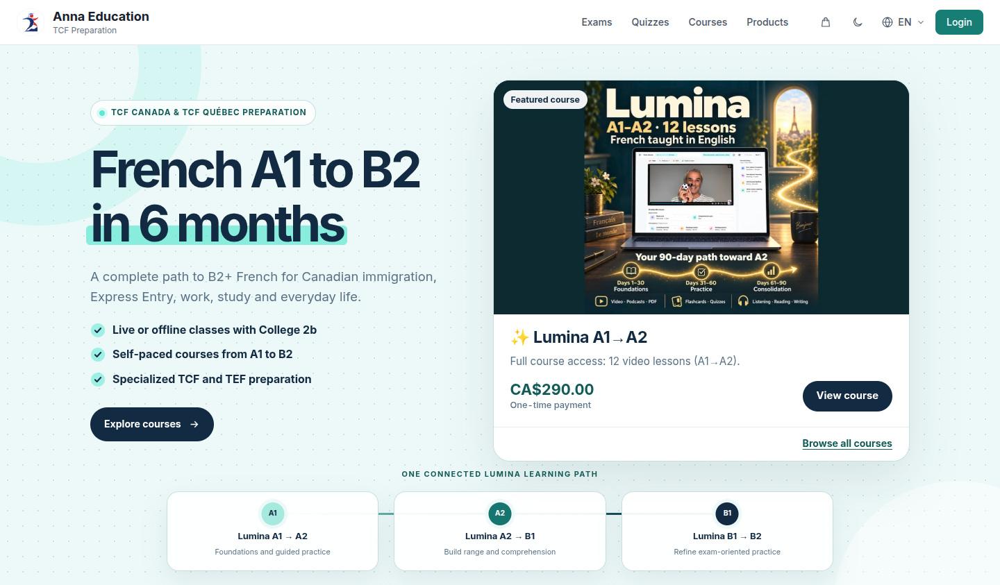

# Anna Education

**French learning and TCF exam preparation for life in Canada**

Éducation Anna Inc. · Montréal, Québec

[**Visit e2ba.com**](https://e2ba.com)

---

Anna Education is an online learning platform that helps people build their French from beginner level (A1) toward B2+ and prepare for the **TCF Canada** and **TCF Québec** exams. We support learners studying French for Canadian immigration, Express Entry, work, study and everyday life.

Our mission is to give every learner a clear, structured path to confident French, with practice that feels close to the real exam.

  

## What learners can expect

- **One connected learning path.** The Lumina courses move step by step from A1 to A2, A2 to B1, and B1 to B2.
- **Many ways to practise in one place.** Video lessons, podcasts and audio, PDF resources, flashcards and quizzes, depending on the course.
- **Exam-style preparation.** Mock tests, practice quizzes, and reading, listening and writing practice for TCF Canada and TCF Québec.
- **Learn your way.** Study at your own pace online, or join live or offline classes with College 2b.
- **Look before you choose.** Selected lessons are open as free previews, and each course page shows what it includes.

## Start learning

**[Explore our courses at e2ba.com →](https://e2ba.com)**

Questions? Contact us at [info@e2ba.com](mailto:info@e2ba.com).

---

Anna Education is an independent exam-preparation platform. It is not affiliated with, endorsed by, or connected to France Éducation international or the official TCF testing bodies.
